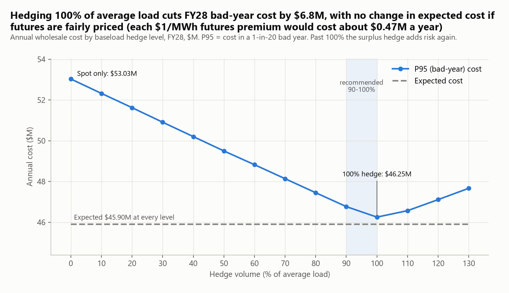
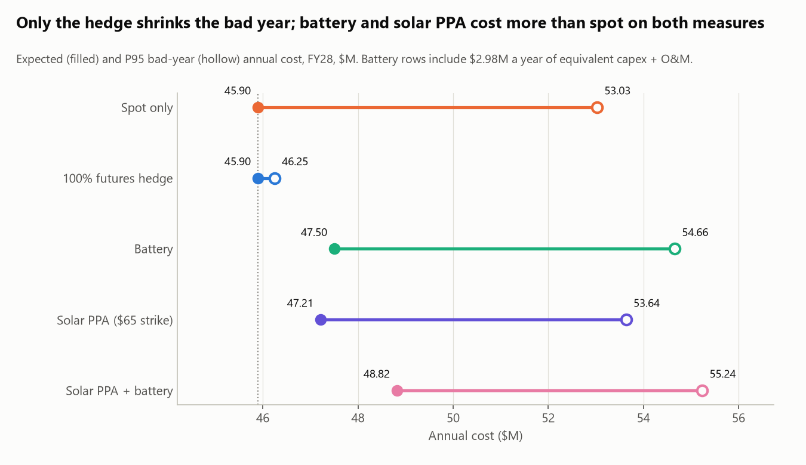
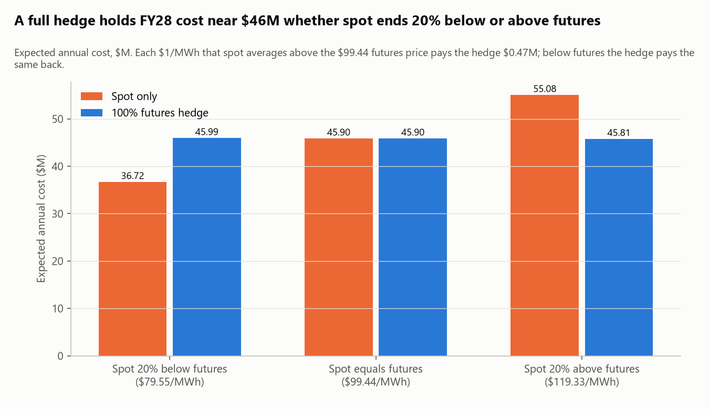
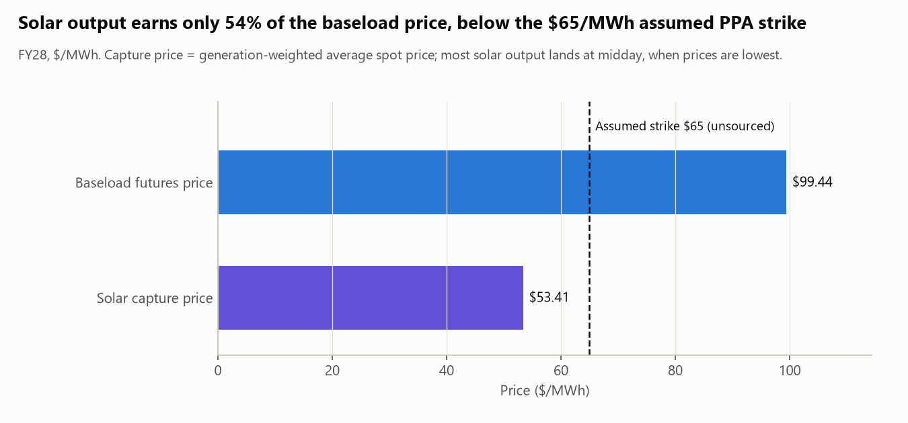
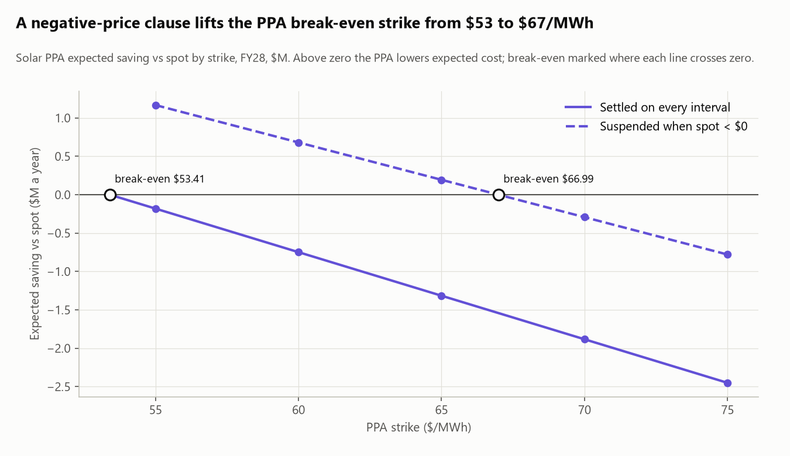
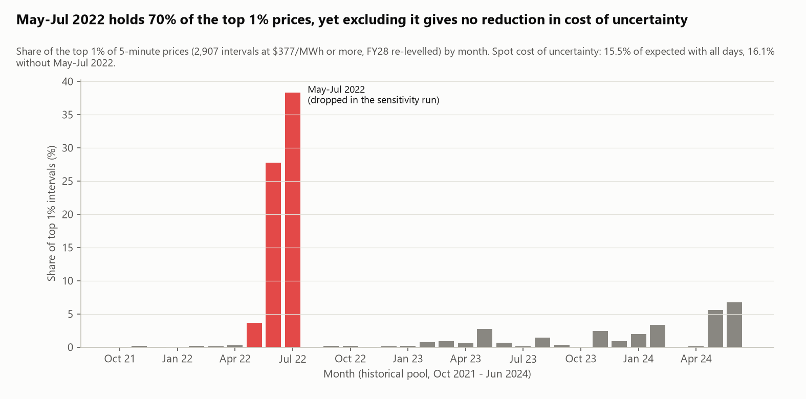
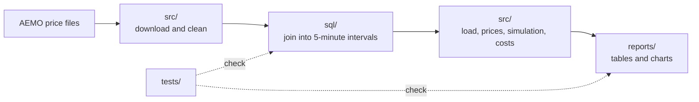

# Powering a 50 MW Data Centre in NSW: What Does Electricity Really Cost, and What Can Go Wrong?

*Capstone project, Master of Business Analytics, final semester (2026)*

**Answer:** hedge 90-100% of average load with ASX baseload futures: in FY28 this cuts the bad-year cost from
$53.03M to $46.25-46.77M, and expected cost stays at $45.90M. That assumes futures are fairly priced; each $1/MWh
futures premium would cost about $0.47M a year at a full hedge. A battery, and a solar PPA at the assumed $65/MWh
strike, both cost more than spot.



## Key findings

> **P95 (bad-year) cost:** the annual cost that only 1 in 20 simulated years exceeds; a plausible bad year.
> **Cost of uncertainty:** P95 minus expected (average) cost; how much extra a bad year costs over a normal one.

1. **Hedge 90-100% of average load: it buys certainty, not savings.** Futures fix the price on almost all the
   load, so a bad year costs nearly the same as a normal one: at a full hedge the FY28 cost of uncertainty falls
   from $7.13M to $0.35M. The average cost doesn't move, because the model prices futures fairly.
2. **Whether the hedge "saves" money depends only on where spot ends up.** If spot averages 20% below futures, the
   100% hedge costs $9.27M more than spot. If it averages 20% above, it costs $9.27M less. Each $1/MWh gap is worth
   $0.47M a year.
3. **Don't invest in a battery yet.** It raises expected cost from $45.90M to $47.50M. NPV is -$14.62M at 8%
   (-$11.80M to -$16.87M across the sensitivities), and payback is 29.5 years against a 15-year life.
4. **Only sign a solar PPA below break-even.** Solar earns $53.41/MWh, 54% of the baseload price. A PPA lowers
   expected cost only at a strike below $53.41, or below $66.99 if settlement is suspended when spot is negative.
5. **Excluding the 2022 crisis doesn't remove the risk.** May-Jul 2022 holds 70% of the top 1% price intervals,
   but without those months the cost of uncertainty doesn't fall (15.5% of expected cost with all days, 16.1%
   without).

All figures are for FY28. Battery figures include $2.98M a year of equivalent capex and O&M (8%, 15 years).
FY29-FY30 results and the hypothesis verdicts are in [the findings report](reports/findings.md).

## Recommendations

In priority order; owners, measures and risks are in [the findings report](reports/findings.md#recommendations).

1. **Hedge 90-100% of average load (48-53 MW) with ASX baseload futures for FY28-FY30**, and check the hedge
   ratio against actual load each month.
2. **Hold off on a battery** and re-run the case with each CSIRO GenCost release as battery costs fall.
3. **Negotiate a solar PPA only with a negative-price suspension clause** and a strike below $66.99/MWh for FY28
   ($69.70 for FY29-FY30).

## Inspiration

In my final semester, our capstone asked how a new data centre in New South Wales should buy its electricity.
Under a semester deadline we delivered a clear recommendation, but one result stayed with me: the futures hedge
appeared to save millions every single year. Hedges usually buy certainty, not savings, so a result that good
deserved a second look. After graduating, I rebuilt the analysis from scratch with new code, the full five-minute
market data and more time to test the assumptions. This project is the question I wished we'd asked from the start.
([Why the answers differ](reports/findings.md#why-this-differs-from-the-original-capstone-analysis))

## The question

For the next three financial years, FY2028-FY2030 (July 2027 to June 2030), how do buying at spot, hedging with
futures, adding a battery or contracting solar compare on what electricity usually costs, and on what it costs in a
bad year? The audience is the data centre's CFO or energy procurement lead, who has to choose a procurement strategy
and decide how much of the load to hedge. Costs are wholesale energy only, in the NSW market.

## What the charts show



The battery ($47.50M expected, $54.66M P95) and the $65 solar PPA ($47.21M, $53.64M) both sit above spot
($45.90M, $53.03M), so the recommended package is the hedge alone.



Whether the hedge "saves" or "costs" money depends only on where spot ends up, which nobody knows when the hedge is
signed.



Most solar output arrives at midday, when prices are lowest, so the energy a PPA delivers is worth $53.41/MWh
against the $99.44/MWh futures price.



Solar output peaks when spot prices are negative, so whether the contract pays out in those intervals matters as
much as the strike itself.



The bad-year tail also comes from short, extreme spikes in other years, so the case for hedging holds without the
2022 crisis. Part of this result may come from re-levelling each year separately
([Limitations](reports/findings.md#limitations)).

## Approach

1. **Data:** downloaded AEMO five-minute NSW spot prices for Oct 2021-Jun 2024 (289,152 intervals) and audited
   them for gaps, duplicates, spikes and price-cap events.
2. **Load:** built a 50 MW data centre load from utilisation, time of day and seasonal cooling overhead.
   50 MW is IT capacity; after utilisation and seasonal cooling overhead (PUE 1.20-1.35), average grid load is
   about 53 MW, which is why the hedge is sized in MW of average load.
3. **Prices:** re-levelled the historical prices so each year averages the ASX futures price for FY28-FY30
   ($99.44 and $103.47/MWh). This keeps the real shape of prices (spikes, seasons, negative midday prices) while
   comparing like with like.
4. **Costs:** costed spot, the futures hedge, a 20 MW / 40 MWh battery and a solar PPA at five-minute resolution.
5. **Simulation:** built 5,000 simulated years per FY from 7-day blocks of real history drawn from the same
   calendar month. Every strategy is costed on the same simulated days, so differences come from the strategy,
   not from luck in the draw.
6. **Sensitivities:** hedge level 0-130%, realised spot 20% above and below futures, PPA strike $55-75/MWh,
   battery discount rate 6-10%, and a run without May-Jul 2022.

**Tools:** SQL on DuckDB for staging and joins; Python (pandas, matplotlib) for the load profile, pricing,
simulation and charts; pytest for tests. I used DuckDB because it runs on any laptop with no server. The queries are
mostly standard SQL; file readers and a few date functions are DuckDB-specific.

## Project structure



The work moves in one direction. Python in `src/` downloads the AEMO price files and cleans them, then the SQL in
`sql/` joins prices, solar output and a calendar into one row per five-minute interval. From there it's Python again.
I build the data centre's load, re-level prices to the futures price, simulate 5,000 years and cost each strategy.
The results are saved to `reports/` as CSV tables, and the charts are drawn from those tables. The tests sit
alongside the whole pipeline and check both the joined data and the costs, so if something goes wrong, a test fails.

If you only open a few files, I'd start with [`sql/04_int_intervals.sql`](sql/04_int_intervals.sql), where all the
inputs meet. [`src/strategies.py`](src/strategies.py) has the cost formula for every strategy and the rule for when the
battery charges. To see how a number in the report is produced, [`src/scenarios.py`](src/scenarios.py) builds every
result table. The [`sql/`](sql/README.md), [`src/`](src/README.md) and [`tests/`](tests/README.md) folders each have
a short README listing their files in the order they run.

```
├── data/
│   ├── raw/             AEMO downloads (not committed; fetched by script)
│   └── processed/       cleaned tables; only the solar output factor is committed
├── sql/                 DuckDB staging models, run in number order
├── src/                 fetch, clean, load, pricing, simulation, strategy costs, scenarios, charts
├── tests/               data-quality and cost-engine tests
├── notebooks/           data audit (needs the local xlsx files; see data/raw/README.md)
├── reports/
│   ├── findings.md      full findings, recommendations and limitations
│   ├── figures/         the 6 charts
│   └── tables/          the result tables every number comes from
└── docs/                project brief, data dictionary, assumptions, decision and validation logs
```

## How I checked the numbers

The AEMO download matches a separate export to within half a cent on all 289,150 shared intervals, and SQL
and pandas versions of the spot cost agree to within one part in a billion. 56 automated tests cover row counts,
price limits, a hand-worked example, a real historical day for every strategy and the battery's physical limits.
Tests were also run against deliberately altered code to confirm they catch errors. Every check and its result is
in the [validation log](docs/validation-log.md).

## Limitations

- **Futures are assumed fairly priced.** This is the assumption behind "no change in expected cost". If futures
  carry a premium over expected spot, every MW hedged has a real cost: about $0.47M a year per $1/MWh at a full
  hedge.
- **Three years of history (Oct 2021-Jun 2024).** A year worse than anything in FY22-FY24 isn't represented, and
  AEMO's $300/MWh cap in June 2022 cut off the crisis tail. This likely understates risk, which strengthens the case
  for hedging.
- **Each year is re-levelled separately.** This may contribute to the result that excluding May-Jul 2022 doesn't
  lower the cost of uncertainty.
- **Wholesale energy only.** Network charges, retail margin, loss factors and environmental charges are excluded.
  The total bill is higher, but these costs are largely the same across strategies.

The full list, including the two unsourced inputs, is in [the findings report](reports/findings.md#limitations).

## How to run

Requires Python 3.13. On Windows, clone to a short path (for example `C:\projects`) because of the 260-character path limit. From the repo root:

```bash
python -m venv .venv
source .venv/bin/activate        # Windows: .venv\Scripts\activate
pip install -r requirements.txt

python -m src.fetch_aemo         # download 36 monthly AEMO price files to data/raw/aemo/
python -m src.clean              # clean prices into data/processed/ (the solar factor is already committed)
python -m src.staging            # run the SQL in sql/ on DuckDB
python -m src.scenarios          # write the 14 result tables to reports/tables/
python -m src.seed_check         # rerun the bootstrap over 20 seeds, write seed_sensitivity.csv
python -m src.viz                # write the 6 charts to reports/figures/
pytest                           # run the 56 tests
```

## Data attribution

Price and demand data: Australian Energy Market Operator (AEMO),
[Aggregated Price and Demand](https://www.aemo.com.au/energy-systems/electricity/national-electricity-market-nem/data-nem/aggregated-data),
NSW1, Oct 2021-Jun 2024. The solar output factor is derived from AEMO dispatch data for an NSW solar farm. AEMO
material is used under the [AEMO Copyright Permissions](https://www.aemo.com.au/privacy-and-legal-notices/copyright-permissions).
Futures prices: [ASX Energy](https://www.asxenergy.com.au/futures/au_electricity), retrieved 28 Oct 2026. Battery
costs: [CSIRO GenCost 2025-26](https://www.csiro.au/en/research/technology-space/energy/electricity-transition/gencost).

## Author

Sarthak Konnur · [LinkedIn](https://www.linkedin.com/in/sarthak-konnur)
