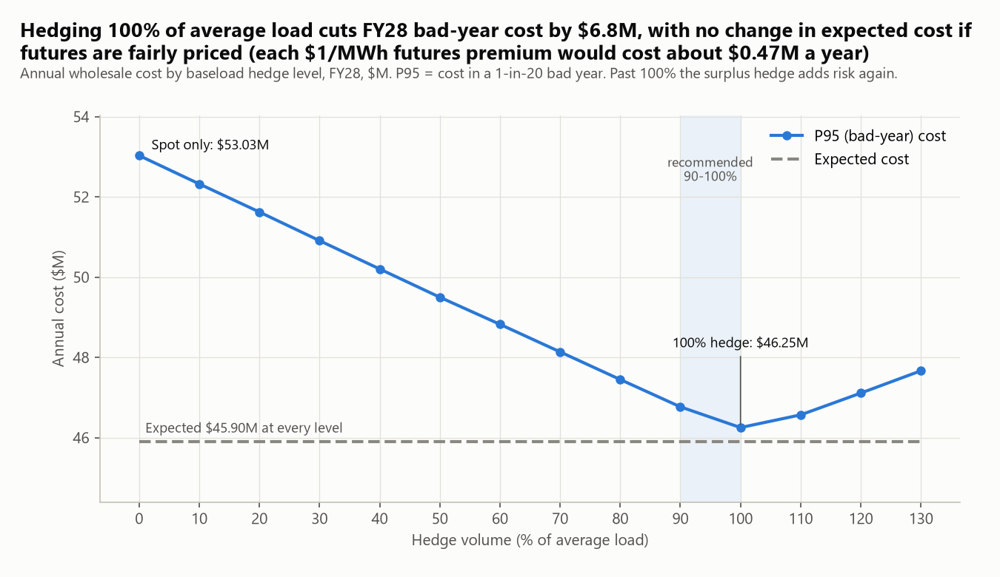
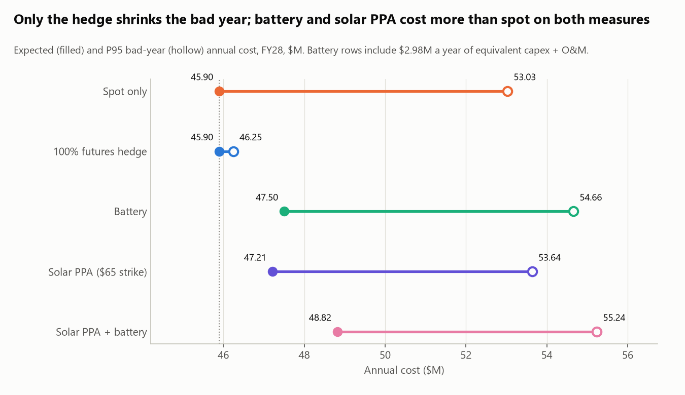
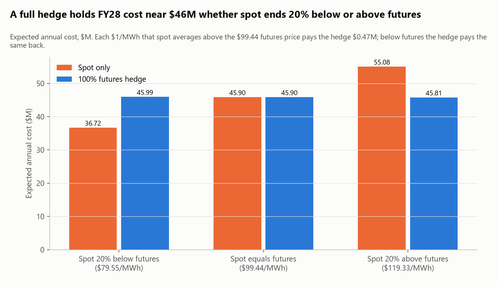
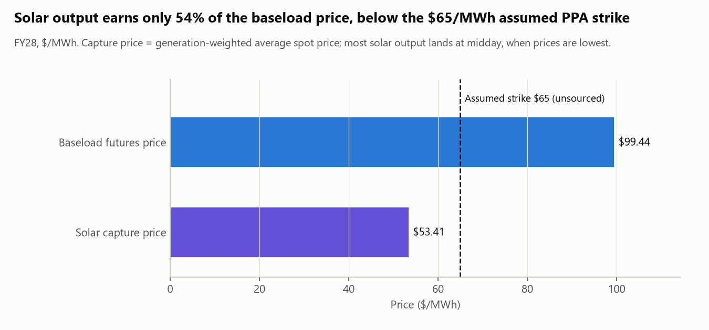
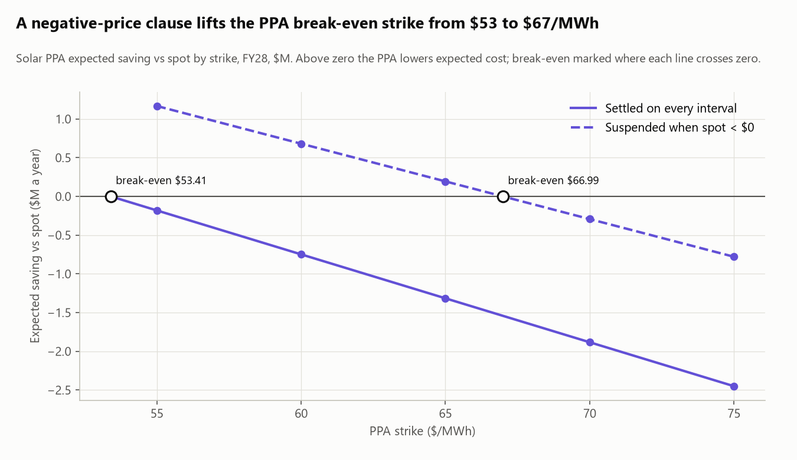
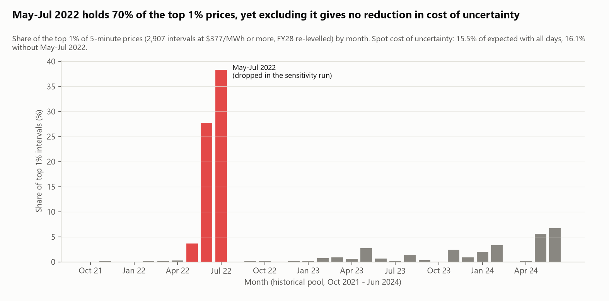

# Findings: electricity procurement for a 50 MW NSW data centre, FY2028-FY2030

**For:** the data centre's CFO / energy procurement lead.
**Question:** how do spot, a futures hedge, a battery and a solar PPA compare on what electricity usually
costs and what it costs in a bad year?

> **P95 (bad-year) cost:** the annual cost that only 1 in 20 simulated years exceeds; a plausible bad year.
> **Cost of uncertainty:** P95 minus expected (average) cost; how much extra a bad year costs over a normal one.

Every figure below comes from a table in `reports/tables/` (named in parentheses) produced by
`python -m src.scenarios`. Costs are wholesale energy only, in $M a year. Expected cost is an exact average over
the bootstrap draws; P95 comes from 5,000 simulated years per FY. Charts are built by `python -m src.viz`.

## Executive summary

1. **Hedge 90-100% of average load.** A baseload futures hedge cuts FY28 P95 cost from $53.03M to $46.77M (90%)
   or $46.25M (100%), and expected cost stays at $45.90M.
2. **The hedge buys certainty, not savings.** If spot averages 20% below futures, the 100% hedge costs $9.27M more
   than spot; if 20% above, $9.27M less. Each $1/MWh that spot ends above or below futures is worth $0.47M a year.
3. **Don't invest in a battery yet.** Including $2.98M a year of capex and O&M, it raises expected cost from $45.90M
   to $47.50M; NPV is -$14.62M at 8% (-$11.80M to -$16.87M) and payback is 29.5 years against a 15-year life.
4. **Only sign a solar PPA below break-even.** Solar earns $53.41/MWh, 54% of the baseload price. A PPA lowers expected
   cost only at a strike below $53.41, or below $66.99 if settlement is suspended when spot is negative.
5. **Bad years are not one crisis.** May-Jul 2022 holds 70% of the top 1% price intervals, but excluding it gives no
   reduction in cost of uncertainty (15.5% of expected cost with all days, 16.1% without).

## Headline figures, FY28-FY30

FY30 uses the FY29 futures price (no FY30 quote was available), so FY29 and FY30 match except for battery rows,
where capacity fade differs. Battery rows include $2.98M a year of equivalent capex + O&M. PPA rows assume a $65/MWh
strike settled on every interval. (`strategy_summary.csv`, `ppa_breakeven.csv`)

| Measure | FY28 | FY29 | FY30 |
|---|---:|---:|---:|
| Baseload futures price ($/MWh) | 99.44 | 103.47 | 103.47 |
| Spot: expected cost ($M) | 45.90 | 47.62 | 47.62 |
| Spot: effective price ($/MWh) | 98.81 | 102.82 | 102.82 |
| Spot: P95 bad-year cost ($M) | 53.03 | 54.92 | 54.92 |
| 90% hedge: P95 ($M) | 46.77 | 48.50 | 48.50 |
| 100% hedge: P95 ($M) | 46.25 | 47.99 | 47.99 |
| 100% hedge: P95 reduction vs spot ($M) | 6.78 | 6.93 | 6.93 |
| Spot: cost of uncertainty ($M) | 7.13 | 7.30 | 7.30 |
| 100% hedge: cost of uncertainty ($M) | 0.35 | 0.37 | 0.37 |
| Battery: expected cost incl. capex + O&M ($M) | 47.50 | 49.20 | 49.23 |
| Battery: P95 incl. capex + O&M ($M) | 54.66 | 56.47 | 56.50 |
| Solar PPA at $65: expected cost ($M) | 47.21 | 48.69 | 48.69 |
| Solar PPA at $65: P95 ($M) | 53.64 | 55.29 | 55.29 |
| PPA + battery: expected cost ($M) | 48.82 | 50.27 | 50.30 |
| Solar capture price ($/MWh) | 53.41 | 55.54 | 55.54 |
| PPA break-even strike, every interval ($/MWh) | 53.41 | 55.54 | 55.54 |
| PPA break-even strike, suspended when spot < 0 ($/MWh) | 66.99 | 69.70 | 69.70 |

Every hedge level has the spot expected cost because the model prices futures fairly (see Limitations).

## Insights

### 1. A full baseload hedge removes most of the bad-year risk at no expected cost

- **What:** P95 cost falls steadily as the hedge grows and is lowest at 100% of average load: $46.25M in FY28
  against $53.03M unhedged. Past 100% it rises again ($47.67M at 130%), because the surplus is sold back at spot.
  Expected cost is $45.90M at every level. (`hedge_curve.csv`, `hedge_recommendation.csv`)
- **So what:** the hedge cuts the FY28 cost of uncertainty from $7.13M to $0.35M, so a bad year costs almost
  the same as a normal one. That makes the energy budget something the CFO can commit to.
- **Now what:** hedge 90-100% of average load (48-53 MW of baseload swaps). At 90% the FY28 P95 is $46.77M,
  $0.52M above the minimum, and the gap leaves room for load coming in below plan.

### 2. Only the hedge shrinks the bad year

- **What:** in FY28 the battery ($47.50M expected, $54.66M P95) and the $65 solar PPA ($47.21M, $53.64M) are
  above spot ($45.90M, $53.03M) on both measures. PPA + battery is highest ($48.82M, $55.24M).
  (`strategy_summary.csv`)
- **So what:** neither add-on lowers cost or risk at current assumptions. The package rule (add an option only if
  it lowers both FY-average expected cost and P95) adds neither, so the recommended package is the hedge alone.
  (`package_rule.csv`)
- **Now what:** start with the hedge; treat the battery and PPA as separate decisions with their own
  break-even tests (insights 4 and 5).

### 3. The hedge buys certainty, not savings

- **What:** if FY28 spot averages 20% below futures ($79.55/MWh), spot costs $36.72M and the 100% hedge $45.99M.
  If 20% above ($119.33/MWh), spot costs $55.08M and the hedge $45.81M. Each $1/MWh gap between realised spot and
  futures moves the hedge payoff by $0.47M. (`realised_vs_futures.csv`, `hedge_breakeven.csv`)
- **So what:** the hedge locks the cost near $46M either way. Whether it "saves" or "costs" money depends only
  on where spot ends up, which nobody knows at signing.
- **Now what:** report the hedge internally as budget certainty, not as a saving, and judge it on the variance
  it removes rather than on its year-end mark-to-market.

### 4. Solar output is worth about half the baseload price, so the strike decides the PPA

- **What:** the FY28 solar capture price is $53.41/MWh, 54% of the $99.44 baseload futures price, because most
  solar output arrives at midday when prices are lowest. At the assumed $65 strike the PPA raises FY28 expected
  cost by $1.32M. (`ppa_breakeven.csv`, `ppa_strike_sensitivity.csv`)
- **So what:** a PPA lowers expected cost only if its strike sits below the value of the energy it delivers.
  Its cost of uncertainty ($6.43M) is a little below spot's ($7.13M), so it is not a substitute for the hedge.
- **Now what:** judge any PPA offer against the break-even strike, not against the baseload price.

### 5. A negative-price clause is worth about $14/MWh of strike

- **What:** suspending settlement when spot is below $0 lifts the FY28 break-even strike from $53.41 to
  $66.99/MWh (FY29-FY30: $55.54 to $69.70). At a $65 strike it lowers FY28 expected cost from $47.21M to
  $45.70M. (`ppa_breakeven.csv`, `strategy_summary.csv`)
- **So what:** solar output peaks when prices are negative, so a PPA settled on every interval pays the strike
  plus the negative price in those intervals. The clause matters as much as the strike itself.
- **Now what:** only negotiate a PPA that includes a negative-price suspension clause, with a strike below about
  $67/MWh for FY28 and $70/MWh for FY29-FY30.

### 6. Bad years come from spikes spread across all years, not one crisis

- **What:** 70% of the top 1% of 5-minute prices (2,907 intervals at $377/MWh or more, FY28 re-levelled) fall in
  May-Jul 2022. Yet re-running without those three months gives no reduction in spot cost of uncertainty:
  15.5% of expected cost with all days, 16.1% without. (`crisis_diagnostics.csv`, `crisis_sensitivity.csv`)
- **So what:** the crisis was a sustained high price level held down by the $300 administered cap, which
  re-levelling scales down. The bad-year tail is associated with short, extreme spikes that occur in every year
  of the pool (for example May 2024 and Feb 2024).
- **Now what:** don't treat 2022 as a one-off that makes spot safe again; the case for hedging holds without it.

## Why this differs from the original capstone analysis

The original capstone found that hedging saved several million dollars a year. That comparison set a 2026
futures price against spot prices from the 2021-22 crisis period, when NSW spot averaged $150.66/MWh
(Oct 2021-Jun 2022) against the FY28 futures price of $99.44/MWh (`relevel_check.csv`). Because the
historical spot was well above the futures price, the hedge showed a large saving.

This analysis re-levels the same history so that spot averages the futures price for each year, which compares like
with like. On that basis the expected saving from hedging is $0 at every hedge level (`hedge_curve.csv`), and the
hedge's value is certainty: it cuts FY28 cost of uncertainty from $7.13M to $0.35M. The original saving is what a
hedge pays when spot ends well above futures (insight 3), which is an outcome, not something known in advance.

## Hypotheses

| # | Hypothesis | Verdict | Evidence |
|---|---|---|---|
| 1 | With fairly priced futures, hedging buys certainty, not savings | Supported | Expected cost $45.90M at every hedge level; P95 $53.03M to $46.25M (`hedge_curve.csv`) |
| 2 | Most of the P95 reduction comes before 100%; the curve flattens | Rejected | P95 falls almost in a straight line to its minimum at 100% (`hedge_curve.csv`) |
| 3 | The battery does not pay back; its value shows in worst-month cost | Partly supported | NPV -$14.62M, payback 29.5 years (`battery_npv.csv`); no worst-month benefit either: $10.72M vs spot $10.67M in FY28 incl. one twelfth of annual capex (`strategy_summary.csv`) |
| 4 | PPA value depends on strike vs capture price; the solar/load mismatch adds risk | Partly supported | Capture price $53.41 vs futures $99.44 (`ppa_breakeven.csv`); PPA cost of uncertainty $6.43M vs spot $7.13M, so no added spread (`strategy_summary.csv`) |
| 5 | Bad-year cost is driven mainly by May-Jul 2022 | Rejected | No reduction in cost of uncertainty without it: 15.5% vs 16.1% (`crisis_sensitivity.csv`) |
| 6 | Suspending PPA settlement at negative prices lowers PPA expected cost | Supported | Break-even $53.41 to $66.99; FY28 expected $47.21M to $45.70M at $65 (`ppa_breakeven.csv`, `strategy_summary.csv`) |

## Recommendations (ranked by impact x ease)

| # | Action | Owner | Expected effect | How to measure | Risks |
|---|---|---|---|---|---|
| 1 | Hedge 90-100% of average load (48-53 MW) with ASX baseload swaps for FY28-FY30 | CFO / energy procurement | FY28 P95 down $6.26M (90%) to $6.78M (100%); expected cost unchanged | Hedge ratio vs actual load each month; actual annual cost vs budget | Volume risk if utilisation runs below plan; margin calls tie up cash; any futures premium becomes a real cost |
| 2 | Don't invest in a battery yet; revisit the case as battery costs fall (CSIRO GenCost 2025-26: 2-hour battery capex down 15% in the latest year) | CFO / strategy | Avoids a -$14.62M NPV at 8% | Re-run `battery_npv` with each new GenCost release | Revenue modelled from energy arbitrage only; other battery revenue streams are not valued |
| 3 | Only negotiate a solar PPA with a negative-price suspension clause and a strike below the break-even ($66.99 FY28, $69.70 FY29-FY30) | Energy procurement | PPA lowers expected cost instead of raising it | Offered strike vs break-even strike in `ppa_breakeven.csv` | Strike assumption is unsourced; one-farm solar profile; LGC value not included |

## Limitations

Carried over from the brief:
- About three years of history (Oct 2021-Jun 2024) means P95 draws on a small number of seasons; a bad year worse
  than anything in FY22-FY24 is not represented.
- Re-levelling by scaling shrinks crisis-era spikes in proportion; the shift sensitivity tests this
  (`shift_sensitivity.csv`).
- The June 2022 administered price cap ($300/MWh) truncated the crisis tail, so history likely understates how bad
  that period could have been without intervention.
- The solar factor comes from one farm and keeps its outage days (12 days with midday output below 5 MW).
- FY30 is held flat at the FY29 settle (no FY30 quote on the retrieval date).
- The load profile is stylised. Hyperscale data centre loads are often flatter, which would make a baseload hedge
  fit even more closely.
- Battery NPV runs 15 years but prices are only observed to FY30; later years assume FY30 levels.
- Wholesale energy only; network charges, retail margin, loss factors and LGC/environmental charges are excluded,
  so the total bill is higher.

Added during the analysis:
- Futures are fair by construction. If futures carry a risk premium over expected spot, every MW hedged has a real
  expected cost.
- P95 is simulated: the seed-to-seed standard deviation of spot FY28 P95 is $0.13M, so P95 gaps under about $0.3M
  between strategies are treated as noise (`docs/validation-log.md`).
- The PPA strike ($65, range $55-75) and battery O&M (2.5% of capex, range 1.5-3.5%) have no citable source; both
  are shown with their ranges.
- The run without May-Jul 2022 draws every simulated July from July 2023.

